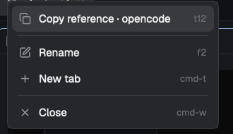

# Herdr Tab Actions

Pinned tabs with close protection, plus copy reference for terminal panes and tabs in Herdr:

- **Pin tab / Unpin tab** — right-click any tab to pin it. Pinned tabs show a pin icon and stay first in the tab bar.
- **Close protection** — bind `cmd+w` to `tabs-ref.closeTab` so pressing close on a pinned tab navigates to the nearest tab instead of closing it.
- **Copy reference** — right-click a tab or terminal pane to copy its `hc` address and context to the clipboard for another agent to control.



## Tab pinning & protection

Right-click a tab to pin it:

- Pinned tabs show a pin icon and always sit before regular unpinned tabs.
- Pin state lives in `shared("tabs.pinned")` and persists across closing and reopening Herdr. Closed tab ids remain harmless because Herdr never reuses tab ids.
- The tab bar reorders the model using `tab.move`, so keyboard navigation (`cmd+1..9`, `tab.next`, `tab.prev`) stays consistent.
- **`cmd+w` never closes a pinned tab:** bind `cmd-w` to `tabs-ref.closeTab`. On a pinned tab, it selects the closest available tab instead of closing. Unpinned tabs close normally. Explicit **Close** in the right-click menu or clicking the close button still closes a pinned tab.

## Copy reference

Right-click a tab or terminal pane → **Copy reference · <program>**.

The clipboard receives a line formatted for agent interoperability:

```text
t9 — herdr · opencode working · "OC | Terminal tab IDs for agent sync" · tab "OpenCode" (tb…) · space "~" (sp…) · /Users/pablowerlang · hc: get/read/send/wait t9
```

Another agent or script can immediately act on it using Herdr Core:

```sh
hc get t9
hc read t9 --lines 80
hc send t9 "npm test"
hc wait t9
```

On remote machines, the address automatically includes the machine target (`machine/t9`).

## Requirements

- Herdr app.
- Clipboard utility: macOS built-in (`osascript`), Linux (`wl-copy` or `xclip`), Windows (PowerShell).

## Install

1. Sync the mods into `~/.config/herdr-app/mods/`:

   ```sh
   ./sync.sh
   ```

2. Point your **personal layout** at `tabs-ref` and `ref-menu`:

   ```json
   {
     "terminal_menu": "ref-menu",
     "children": [
       {
         "id": "tabs",
         "type": "block",
         "content": { "mod": "tabs-ref" }
       }
     ]
   }
   ```

   If using a shipped layout, clone it first:

   ```sh
   herdr-app do layout.clone --name main --as my-layout
   ```

3. Bind `cmd-w` in `~/.config/herdr-app/keys.json` to enable pinned tab protection:

   ```json
   {
     "keys": {
       "global": {
         "cmd-w": "tabs-ref.closeTab"
       }
     }
   }
   ```

4. Verify:

   ```sh
   herdr-app check ~/.config/herdr-app/mods/tabs-ref
   herdr-app check ~/.config/herdr-app/mods/ref-menu
   ```

## Repository

Source of truth for both mods. After edits:

```sh
./sync.sh
```

## Publish

This repo is an app-mod repo. To share it on `herdr.dev/mods`:

- keep `mods/tabs-ref` and `mods/ref-menu` at the root;
- keep `RECIPE.md` and `preview.png`;
- add the topic `herdr-mod`;
- make the repository public.
