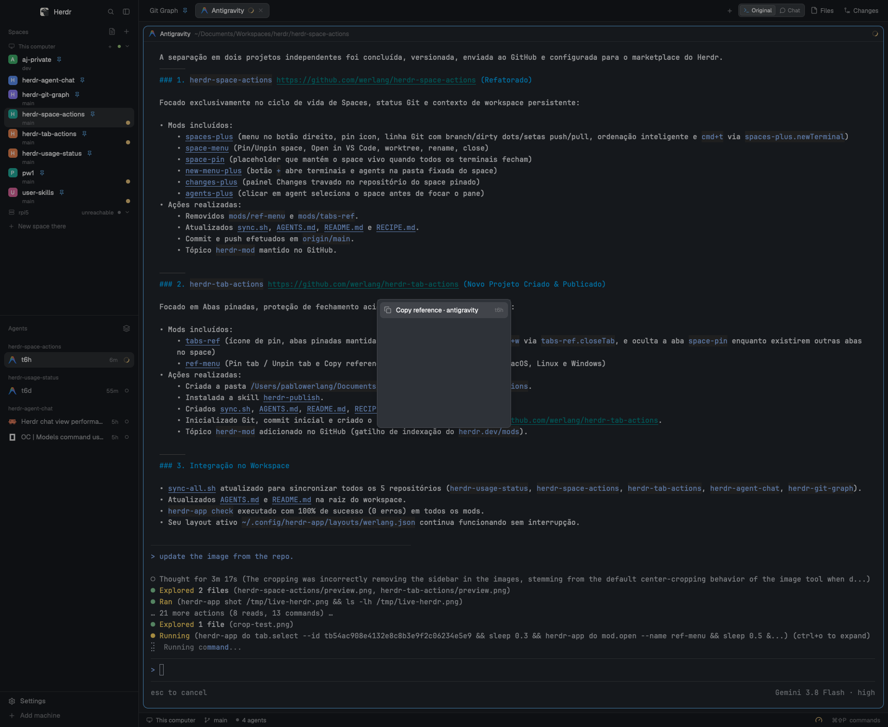

# Tab Actions & Terminal References

Right-click a **tab** in Herdr for **Pin tab** and **Copy reference**, and right-click a **terminal pane** for **Copy reference**.

## What you see

Right-clicking a tab opens a context menu with:

- One **Copy reference · <app>** row per live terminal in the tab.
- **Pin tab** / **Unpin tab** — pinned tabs show a pin icon and stay first among regular tabs.
- **Rename**
- **New tab**
- separator
- **Close**

Right-clicking a terminal pane opens the same menu rooted on that pane's terminal and pane actions (split, zoom, park, close).

## How it behaves

- **Pin tab** stores the tab id in `shared("tabs.pinned")` and moves the tab to the front of regular tabs.
- `tabs-ref` reorders the model using `tab.move`, so pinned tabs stay first after dragging, opening new tabs, or restarting.
- `cmd-1`..`cmd-9` bound to `tabs-ref.select1`..`select9`: selects the Nth tab the bar shows; the hidden placeholder is skipped and out-of-range numbers do nothing (no error).
- `cmd-t` bound to `tabs-ref.newTab`: opens or selects the **New tab** (`space-pin`) placeholder instead of starting a terminal directly.
- `cmd+w` bound to `tabs-ref.closeTab`: on a pinned tab it does not close; it selects the closest available tab (ties break to the right). On unpinned tabs it calls `tab.close`.
- **Copy reference** writes the terminal's `hc` address and full tab/space/folder metadata to the system clipboard.
- Supports macOS, Linux (`wl-copy`/`xclip`), and Windows.
- On a TUI application that captures the mouse, **Shift+right-click** opens the pane menu.
- While a space has other tabs, `tabs-ref` hides placeholder tabs (such as `space-pin`); it reveals them when selected or when all other tabs close.
- The `+` sits after the last visible tab and opens `new-menu-plus` in one click; without that mod it opens a terminal tab directly.

## Built from

- `mods/tabs-ref/` — clone of the shipped `tabs`; opens `ref-menu` on right-click, renders the pin icon, reorders pinned tabs, and answers `tabs-ref.closeTab` / `tabs-ref.pin`.
- `mods/ref-menu/` — clone of the shipped `menu`; adds the `ref.copy` item (clipboard writer per platform) and the Pin/Unpin tab item. `ref.js` builds the reference line without importing `herdr`, keeping it testable in plain Node.
- `shared("tabs.pinned")` — app-wide pinned tab ids.
- Layout wiring points `tabs` at `tabs-ref` and root `terminal_menu` at `ref-menu`.

## Watch out

- **Both mods are required:** `tabs-ref` depends on `ref-menu`; installing only one loses either the tab menu or the pane menu.
- `space-pin` (from `herdr-space-actions`) is optional: it provides the hidden New tab placeholder that `tabs-ref` hides and restores. Without it, the tab bar still works. The placeholder icon is bundled in `mods/tabs-ref/new-tab.svg`.
- `cmd+w` must point at `tabs-ref.closeTab` (not `tab.close`) for pinned tabs to protect themselves.
- Linux **Copy reference** needs `wl-copy` or `xclip`.
- Do not rename `tabs-ref` or `ref-menu`: asset paths and `openOverlay` calls use those folder names.

## Done when

- `herdr-app check` passes for `tabs-ref` and `ref-menu`.
- Right-clicking a tab shows Pin/Unpin and Copy reference.
- Pinned tabs show a pin icon and move to the front.
- `cmd+w` on a pinned tab selects the closest tab instead of closing.
- Copy reference places the correct `hc` address on the clipboard.
- `herdr-app status` reports no errors.
